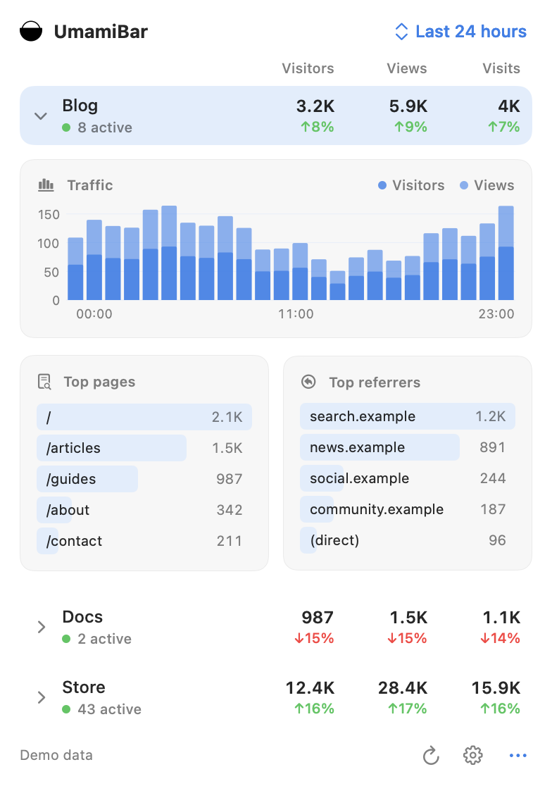

<div align="center">

# UmamiBar

**点一下 macOS 状态栏，就能查看 Umami 网站统计。**

[下载最新版](https://github.com/gentpan/UmamiBar/releases/latest) · [English](README.md) · [反馈问题](https://github.com/gentpan/UmamiBar/issues)



*截图中的站点与统计均为演示数据。*

</div>

UmamiBar 是 [Umami](https://umami.is) 的原生 macOS 状态栏客户端。无需打开浏览器，就能查看实时在线人数、访客、浏览量与访问次数；展开站点后，还可以查看流量趋势、热门页面和来源网站。平时只在状态栏显示一个图标，点击后才打开下拉面板。

## 功能

- **只关注需要的站点**：显示全部站点，或勾选指定站点。只选择一个时，打开面板默认展开详情。
- **一根柱子，两种蓝色**：深蓝显示访客，浅蓝显示浏览量。两个指标从同一基线覆盖显示，不把数值相加。
- **今日固定 24 小时**：00:00–23:00 始终占据完整横轴。缺少数据和未来时段留空，已有柱子不会被拉宽。
- **详情一眼可读**：显示前五个热门页面与来源网站、在线人数，以及 Umami 返回的对比变化。
- **多种时间范围**：今天、最近 24 小时、最近 7 天、最近 30 天、本月，使用 Mac 的本地时区。
- **简洁的下拉面板**：纯白不透明背景、小号黑色 logo、对齐的卡片和隐藏的滚动条。刷新时只在右侧刷新按钮显示加载指示。
- **两种连接方式**：支持自建 Umami 与 Umami Cloud，内置简体中文和英文界面。

## 安装

下载版本需要 **macOS 26 或更新版本**，以及 **Apple 芯片 Mac**。

1. 在 [最新 Release](https://github.com/gentpan/UmamiBar/releases/latest) 下载 **UmamiBar-macOS.zip**。
2. 解压后，将 **UmamiBar.app** 移到“应用程序”文件夹。
3. 打开应用，点击顶部状态栏的柱形图图标。
4. 点击面板右下角齿轮，配置连接。

正式下载包已使用 **Developer ID Application** 签名、通过 **Apple 公证**并附加公证票据。自行编译的版本需要另行签名和公证后再分发。

## 配置连接

| 类型 | 需要填写 |
| --- | --- |
| 自建 Umami | 服务器地址、用户名与密码；服务器支持时也可使用 API 密钥。地址末尾带 `/api` 同样支持。 |
| Umami Cloud | Cloud API 密钥，以及 Auto、US 或 EU 区域。可在 Umami Cloud → Settings → API keys 创建密钥。 |

先点击“测试连接”，再点击“保存”。密码和 API 密钥保存到 macOS 钥匙串；登录令牌只保留在内存，不写入应用安装包或仓库。

暂不支持交互式双重认证。自建账号如启用了双重认证，请在服务器支持的情况下使用 API 密钥。

### 选择显示的站点

进入 **设置 → 显示站点**，选择“全部站点”或“指定站点”，然后保存。指定模式至少需要勾选一个站点；隐藏站点只影响本应用的面板，不会删除 Umami 中的站点。

只选一个站点时，每次打开面板会自动展开详情。手动收起后，定时刷新不会强制展开；下次重新打开面板时会再次展开。

### 刷新与开机启动

面板右下角可手动刷新，设置中可选择每 30 秒、1 分钟或 5 分钟自动刷新。将应用移到固定位置后，可以开启“登录时启动”。如系统要求批准，请进入“系统设置 → 通用 → 登录项”允许应用启动。

## 从源码构建

需要 macOS 26+、Xcode 26+ 和 Swift 6.2+。Swift Package 没有第三方依赖。

```sh
git clone https://github.com/gentpan/UmamiBar.git
cd UmamiBar
make test
make build
open build/UmamiBar.app
```

| 命令 | 用途 |
| --- | --- |
| `make test` | 运行模型、API 和应用流程测试。 |
| `make build` | 构建并验证 `build/UmamiBar.app`。 |
| `make run` | 构建并启动状态栏应用。 |
| `make preview` | 打开带演示数据标识的预览窗口。 |
| `make clean` | 清理本地构建产物。 |

构建脚本依次尝试 Developer ID 证书、本地开发证书和临时签名，不会自动执行 Apple 公证。请勿提交证书、私钥或签名凭据。

预览模式使用独立设置和内存凭据。“连接并预览”可以临时检查真实连接；退出预览后，在正式应用中保存连接，才能永久保留账号配置。

## 可靠性与隐私

- 单个站点请求失败时显示提示。已有统计可能继续显示，但失效的在线人数会清空；部分刷新失败不会更新“成功刷新”的时间。
- 详情加载失败可以重试；旧时间范围、旧连接的迟到结果不会覆盖当前界面。
- 重复刷新会合并；Cloud 请求会控制频率，并对限流响应进行有限重试。
- 统计请求发送到你配置的 Umami 服务，应用不添加额外的分析服务。
- 自动化测试使用模拟响应。自建服务器的登录、账号保存和实际状态栏面板已做过实测；Cloud 使用模拟 API 响应验证。

## 项目结构

```text
Sources/UmamiBar/       面板、设置、图表与应用状态
Sources/UmamiBarCore/   Umami 客户端、模型、设置和钥匙串存储
Resources/             应用信息、图标和翻译
Tests/UmamiBarTests/    回归测试
Scripts/               打包与图标生成
```

## 反馈与贡献

反馈问题时，请提供 macOS 版本、Umami 类型与版本、时间范围及复现步骤。截图和日志请先移除密码、令牌及私密统计。提交代码修改前，请运行 `make test` 并检查实际状态栏面板。
